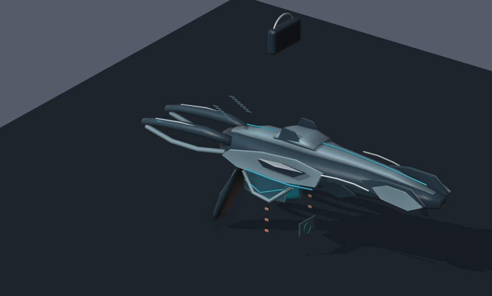
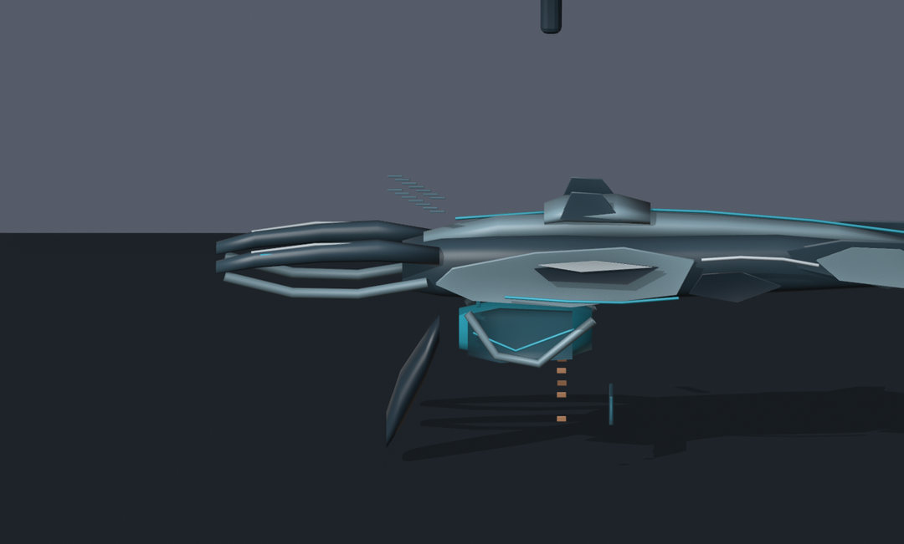
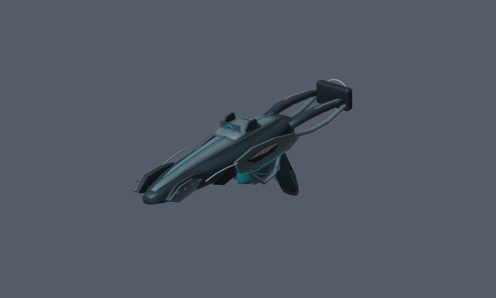

# CROSSFire / AETHER Phase 1.3 — Visual Geometry Review

**Purpose:** Review a fictional, nonfunctional sci-fi game-art asset. This is a **Blender geometry / silhouette study**, not a real mechanism, production UV atlas, or finished texture bake.

## Camera review

### Three-quarter / Hero

### Side profile

### Rear / reverse three-quarter

## Changes in 1.3

- Artist-directed silhouette refinement using broad exterior shapes and restrained luminous accents
- Correct world-space Blender axis conversion for the entire scene, including the positions of separate visual elements
- New consistent studio background and three camera positions
- Blender Workbench review renders generated through virtual software OpenGL (no physical GPU dependency)
- Automated checks that reject empty or near-black preview images
- Compact linked preview images for visual QA independently of Render hosting

## Validated build output

The GitHub Blender job passed mesh export and nonblank image checks. **75 mesh objects** are present in the editable Blender scene; the intermediate asset report lists **4,864 unmodified base triangles**, before export triangulation and modifiers. Nine named material families are included. The GLB is validated as glTF 2.0 binary.

**Next gate:** These images should be checked for consistent grouping, clipping, floating geometry, and silhouette readability. Final texture UV unwrapping and baking are explicitly not complete. The multiplayer game was not modified.

## Technical locations

- Blender modeling script: `tools/aether9_blender_phase1.py`
- Review image validation: `tools/make_aether_thumbnails.py`
- Editable scene and exported asset: `art/blender/` and `static/assets/`
- Existing Asset Lab: `static/aether9-blender-phase1.html`
