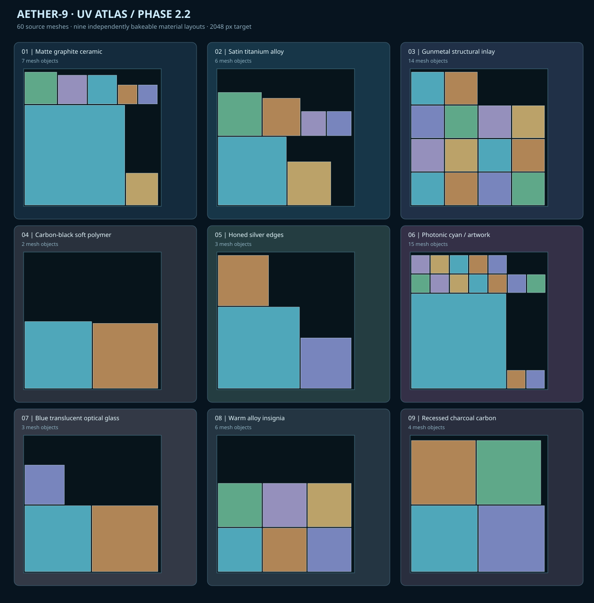

# CROSSFire · AETHER-9 SPECTER — Phase 2.2 UV Mapping

**Status:** Blender build passed and published. **Scope:** original fictional science-fiction game-art surfaces. No modifications to gameplay, collisions, or operational mechanisms.

## Result

The *actual Blender-authored source mesh geometry* has been smart-unwrapped, UV tiled by material family, saved in the native `.blend`, and exported as glTF 2.0.

- **60 source Blender meshes** mapped into **nine separate material-family UV layouts**
- **8,432 source UV loops** generated
- **15 additional Blender curves** retained in native form; their GLB-only mesh conversions are also UV-enabled
- **2,048 × 2,048 planned texture-map resolution per material family**
- **10-pixel reserved UV tile gutter** at the material-atlas target size
- **No cross-object tile overlaps** within a single material family (validated both by the Blender script and GitHub CI)
- Every exported GLB mesh primitive has a `TEXCOORD_0` attribute (build validation passed)
- The exterior model, eight semantic art groups, and the three visual review scenes remain unchanged

## Visual UV layout gallery

The blocks represent each source object's allocated nonoverlapping rectangle in its shared material-family atlas. **This diagnostic shows object allocations, not individual polygon UV islands.** Smart UV Project creates the actual islands inside those allocations.

## Material atlas inventory

| Material family | Authored meshes | Occupied tile-area fraction |
|---|---:|---:|
| Matte graphite ceramic | 7 | 75.72% |
| Satin titanium alloy | 6 | 57.73% |
| Gunmetal structural inlay | 14 | 76.81% |
| Carbon-black soft polymer | 2 | 45.72% |
| Honed silver edges | 3 | 61.62% |
| Photonic cyan | 15 | 70.82% |
| Translucent optical glass | 3 | 53.90% |
| Warm alloy insignia | 6 | 59.73% |
| Recessed charcoal carbon | 4 | 88.89% |
| **Total** | **60** | — |

## UV strategy

1. Use Blender **Smart UV Project** with a 64° angular split threshold and 0.023 island margin on each cleaned source mesh.
2. Compute each object's surface area and assign a size-weighted UV rectangle within its material atlas. Tiny details receive a minimum allocation so they do not disappear entirely.
3. Store every object's UV coordinates inside its assigned rectangle, preserving UV aspect ratio.
4. Verify UV coordinates are finite, polygons do not collapse in UV space, rectangles fit the unit square, and material-sharing objects have non-overlapping reserved tiles.
5. Preserve named native UV layers and per-object atlas bounds in the phase manifest.
6. Convert artistic ribbon curves only during GLB export and generate their own temporary UV layouts, preserving the original editable curves in the native Blender project.

## Important limitations

**No texture maps have been baked or painted yet.** This stage produces UV coordinates and material-specific texture-space layouts for later use.

The **10-pixel gutter** applies between allocated *objects*. Blender Smart UV Project manages spacing *between islands within each object*, which varies with allocated tile size. Thus, guaranteed 10-pixel per-island padding is **not** claimed.

Estimated texture density is similar for most objects *within* a material family but is not constant across all nine atlases; materials have different surface scales and some small features receive a minimum allocation. **Phase 2.3** will audit actual island padding, UV overlap, layout distortion, and consistency at the final bake resolution.

GLB-only ribbon UVs are intentionally separate from the baked material-family mesh atlases. Before Phase 3 baking, ribbon material assignment must be isolated from any mapped PBR material used by authored meshes, so they do not sample unrelated atlas pixels.

## Artifacts

- **Editable Blender project:** `art/blender/aether9-specter-phase1.blend`
- **Updated GLB asset:** `static/assets/aether9-specter-phase1.glb`
- **Detailed UV audit:** `art/blender/aether9-phase2-uv.json`
- **UV atlas overview:** `static/previews/aether9-phase2-uv-layout.svg`
- **Scene manifest:** `art/blender/aether9-phase1-manifest.json`
- **UV authoring code:** `tools/aether_uv22.py`
- **Blender build pipeline:** `.github/workflows/aether-blender-phase1.yml`

## Next: Phase 2.3

Inspect UV island continuity, actual padding in final pixel space, texture density, and material/UV correctness. Fix mapping defects before starting PBR texture work in Phase 3.
