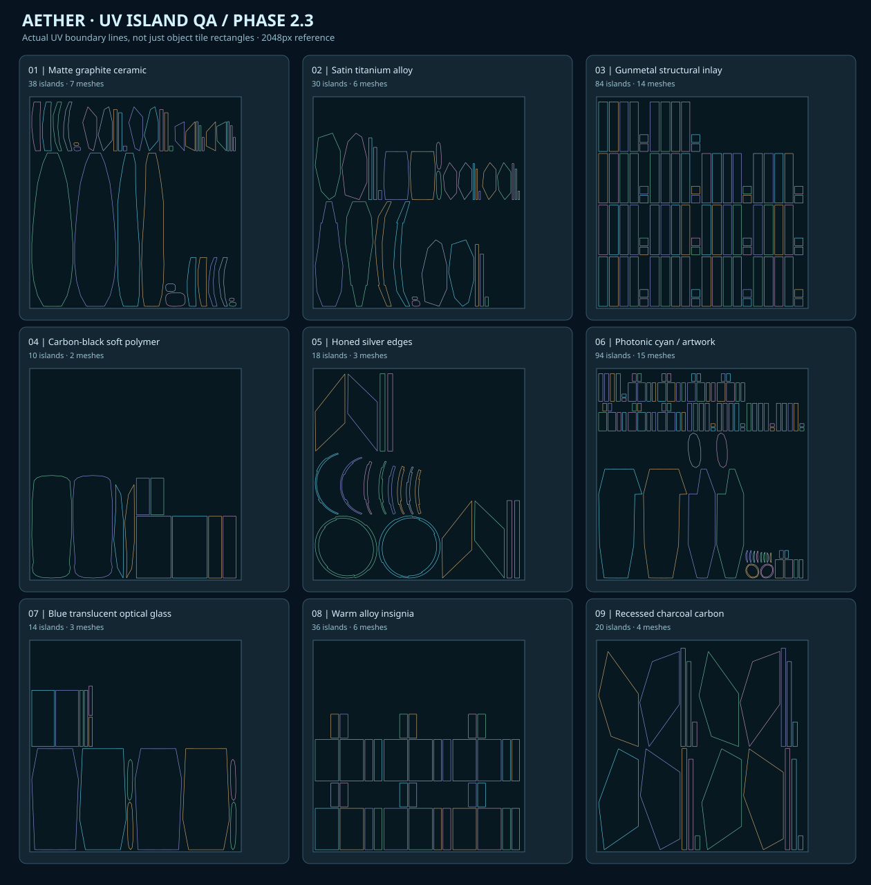

# CROSSFire — Project AETHER / Phase 2.3 UV Quality Assurance

**Status:** PASS — rebuilt and validated in GitHub Actions; published on `main`.

**Scope:** UV mapping quality for an original, fictional sci-fi game-art prop. No texture baking, rendering-system changes, gameplay changes, or physical hardware instructions.

## Findings and corrective action

The first island-level audit on the Phase 2.2 unwrap revealed **48 mesh objects below the required 8-pixel internal island clearance**, though it found **no overlapping triangle interiors** and no high-stretch warnings.

The corrective build replaced a fixed Smart UV Project margin with **adaptive island spacing based on each object's allocated pixel footprint**. Small ornaments, visor features and lighting inlays receive more gap; large exterior meshes keep a smaller margin and more useful texel area.

The rebuilt asset passed all checks.

| QA metric | Final measured result |
|---|---:|
| Authored meshes audited | 60 |
| Material-family UV layouts | 9 |
| Actual UV islands | 344 |
| UV polygons inspected | 2,194 |
| UV triangles examined | 4,044 |
| Overlapping UV triangle interiors | **0** |
| Meshes with inadequate internal island spacing | **0** |
| Required internal island padding | **8 px** at 2048px atlas size |
| Smallest measured within-mesh island spacing | **9.305 px** |
| UV stretching warnings | **0** |
| Converted decorative curve meshes with export UVs | 15 |

### Minimum UV island separation by material family

| Material | Smallest within-mesh gap |
|---|---:|
| Matte ceramic | 10.03 px |
| Satin titanium | 9.30 px |
| Gunmetal | 13.25 px |
| Polymer | 13.56 px |
| Silver details | 16.74 px |
| Cyan lightwork | 11.06 px |
| Optical glass | 11.06 px |
| Copper insignia | 13.44 px |
| Recessed carbon | 14.00 px |

## Actual UV island gallery

The graphic plots **real boundary segments from the Blender UV faces** for every authored mesh; unlike Phase 2.2's block overview, it reveals the island geometry inside the assigned tiles.

## Validation methodology

- Trace UV face connectivity through shared source mesh edges, with a small coordinate tolerance to identify seams.
- Test area intersections between actual UV triangles *within each source mesh*, not only object rectangle boxes. Shared zero-area boundaries do not count as overlaps.
- Measure exact minimum segment distance between different UV island outlines, at a planned 2048px reference atlas resolution.
- Check area-weighted triangle texel density and a mapped-vs-world-space edge-length-ratio proxy to flag exceptional stretching.
- Preserve Phase 2.2's separate **nonoverlapping object allocations within each material family**, so independent source meshes cannot collide with each other in a texture atlas.
- Keep the 15 photonic/ornamental Blender curves editable; UVs are added to their temporary converted meshes for GLB export.

**Important limitation:** The audit detects UV intersections *within* individual meshes and uses Phase 2.2 tile separation to exclude intersections *between* different objects. The 8-pixel minimum applies to distinct UV islands **inside each authored mesh**. The density and stretch measurements are diagnostic proxies, not a guarantee of zero visible distortion in every possible texture.

## Files

- [Per-object QA JSON](../art/blender/aether9-phase2-uv-quality.json)
- [Actual UV island visualization](../static/previews/aether9-phase2-islands.svg)
- [UV material atlas allocations](../art/blender/aether9-phase2-uv.json)
- [Updated editable Blender project](../art/blender/aether9-specter-phase1.blend)
- [Updated glTF 2.0 binary](../static/assets/aether9-specter-phase1.glb)
- Source: `tools/aether_uvqa23.py`, `tools/aether_uv22.py` and `tools/aether9_blender_phase1.py`
- Automated validation: `.github/workflows/aether-blender-phase1.yml`

## What's next

The mesh topology and UV foundations are ready for **Phase 3.1 — authoring visual PBR material families**. Material textures, physically based roughness/metalness maps, and normal/AO baking are *not* part of Phase 2.3 and still require their own validation. Any texture work should respect the nine separate atlas spaces and the fact that decorative-ribbon export UVs are **not** packed into the main material atlases.

The hosted Render build is outside this QA pass; GitHub build success does not imply that the current website has deployed the new model.
