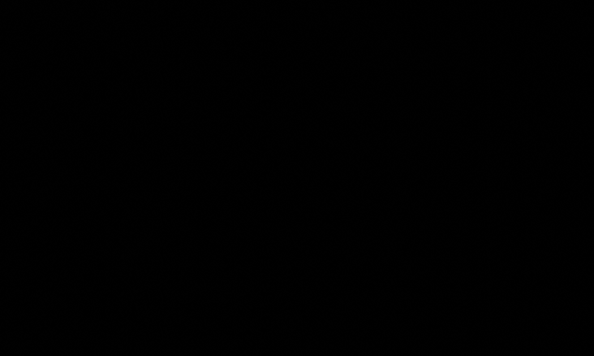
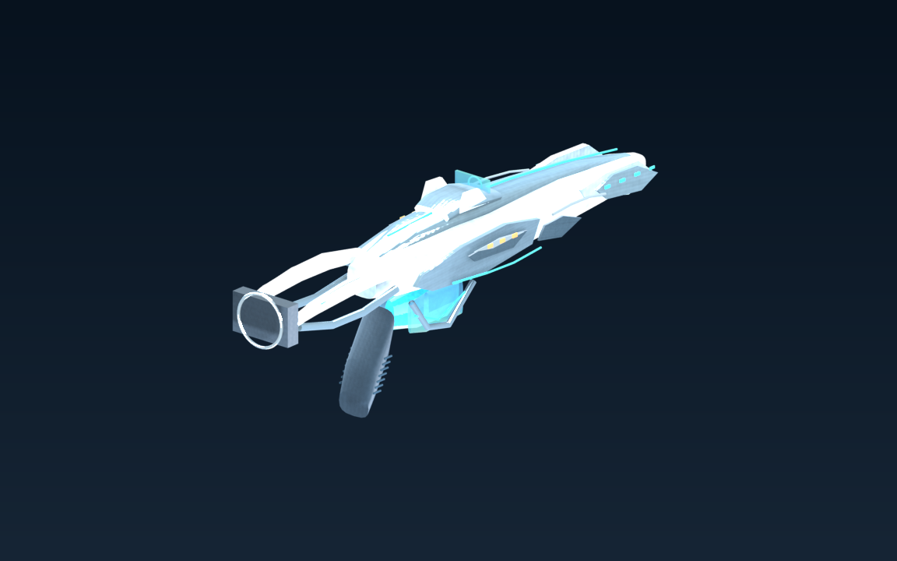

# CROSSFire / Project AETHER — Phase 3 Complete
## AETHER-9 SPECTER · Image-based PBR material production

**Status: Complete for the original fictional game-art asset.** Blender's Phase 3 build and the independent Eevee GLB visual-review job have both passed. **Not yet optimized or integrated into multiplayer.**

The new production source and its three actual textured GLB exports are in GitHub `main`; this is a standalone art asset, not a physical mechanism.

### 3.1 — Surface materials

Nine distinct image-based PBR material families: graphite ceramic, satin titanium, gunmetal, carbon-black polymer, honed silver, photonic cyan, translucent optic glass, copper insignia, and recessed carbon.

Principled BSDF material graphs connect actual image texture maps to base color, metallic/roughness (packed ORM), tangent normal, and emission where appropriate. Glass maintains transparency. The glTF export embeds 29 texture images per variant and connects them to nine material bindings, including packed ambient occlusion.

### 3.2 — Texture baking

**Nine true geometric ambient-occlusion bakes** were produced using Blender Cycles from the UV-unwrapped source geometry. They were calculated at 512×512 to make CPU baking practical, then upscaled to the 2048×2048 material atlas size. This produces real AO information but does **not** create 2K geometric AO detail.

**Nine tangent normal textures** were generated by baking gradients of artist-authored procedural microheight fields (grain, brushed surfaces, etched seams). This is surface-detail normal generation, **not** a high-poly-to-low-poly mesh normal bake. The limitation is explicitly recorded so it is not mistaken for a sculpt-derived displacement pipeline.

### 3.3 — Real texture maps

**51 produced material PNGs:** 27 variant-specific base-color maps, nine shared ORM maps, nine shared normal maps and six variant-specific emissive maps. Also included are nine intermediate 512px AO bakes.

Shared material-family UV atlases remain separate, with the Phase 2.3 quality gates (344 islands, no overlaps, measured padding) preserved. Source maps are in `static/textures/aether9/`. Texture images use 2048×2048 atlas files, except 512×512 original AO bakes.

**glTF ORM channel contract:** R = occlusion, G = roughness, B = metallic. All nine exported PBR materials bind base color, normal, metallic-roughness and occlusion textures; two materials additionally bind emissive textures.

### 3.4 — Three independent cosmetic versions

| Finish | Styling | Validated GLB size |
|---|---|---:|
| **Midnight** | Charcoal ceramic, steel, electric cyan | 44,529,064 bytes |
| **Glacier** | Pale ceramic and silver-blue, icy cyan | 48,197,220 bytes |
| **Eclipse** | Violet-graphite, purple illumination, warm accents | 45,218,604 bytes |

Each is a separate, complete, self-contained glTF 2.0 binary with the same 75-mesh layout, independent embedded material textures, and the same core geometry. Exported assets are not yet configured as low-end-laptop replacements.

## Verified image gallery

### Midnight

### Glacier

### Eclipse

**Image verification:** The GitHub preview workflow independently imported each GLB into Blender, rendered its actual texture-backed materials with Eevee, and validated sufficient rendered mesh coverage and significant pixel differences between all three appearances. The original inline Cycles render pass generated near-black images on the GitHub runner, so the visually verified Eevee images above supersede them. These pictures are direct renderings of the exported models, not AI-generated concepts.

## Download / source locations

- Editable native PBR model (Midnight scene): [`art/blender/aether9-specter-pbr.blend`](../art/blender/aether9-specter-pbr.blend)
- Actual GLBs: [Midnight](../static/assets/aether9-specter-midnight.glb) · [Glacier](../static/assets/aether9-specter-glacier.glb) · [Eclipse](../static/assets/aether9-specter-eclipse.glb)
- Generated texture PNGs: [`static/textures/aether9/`](../static/textures/aether9/)
- Material recipe and exporter: `tools/aether_pbr_phase3.py`
- Blender modeling scene: `tools/aether9_blender_phase1.py`
- Independent Eevee preview renderer: `tools/aether_pbr_preview.py`
- Build report: [`art/blender/aether9-phase3-report.json`](../art/blender/aether9-phase3-report.json)
- Verified image checks: [`static/previews/aether9-pbr-visual-qa.json`](../static/previews/aether9-pbr-visual-qa.json)
- Main Blender CI: `.github/workflows/aether-blender-phase1.yml`; PBR preview QA: `.github/workflows/aether-pbr-preview.yml`
- Interactive showroom page prepared: [`static/aether9-pbr-showroom.html`](../static/aether9-pbr-showroom.html)

## Remaining work outside Phase 3

Phase 3 produced actual PBR assets and visually checked them; it does **not** certify performance or visual quality for classroom hardware. The GLBs are currently 44–48 MB each, which is too heavy to treat as a finished Performance-mode weapon asset without further optimization. Phase 4 covers visual polish and presentation; Phase 5 covers LODs and GPU-friendly texture reductions, in-game cosmetic integration, animation matching and multiplayer performance validation.

**Deployment constraint:** The Render hosting build budget was exhausted. GitHub files and the previews above are available now, but the updated static showroom may not yet be reachable at the public game domain.
